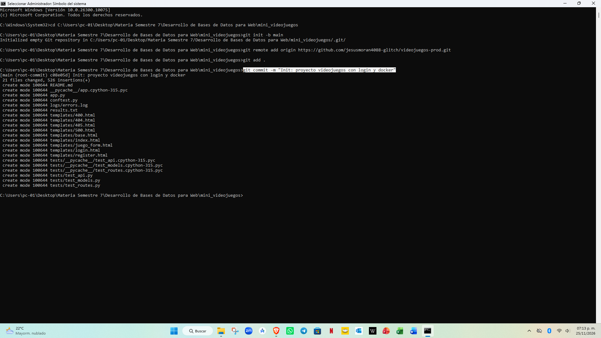
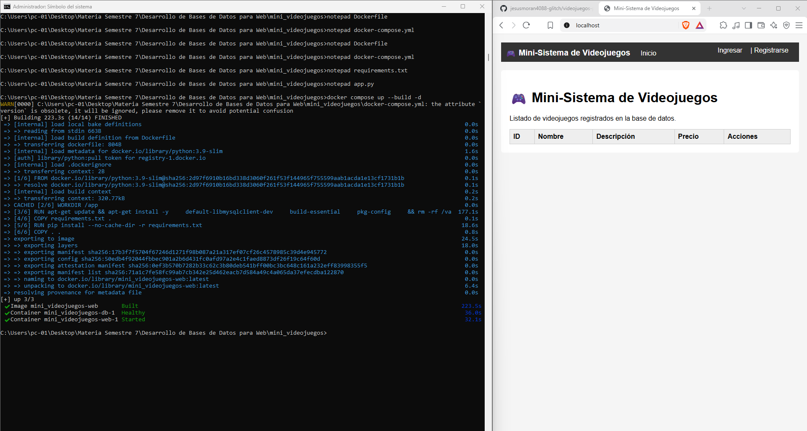
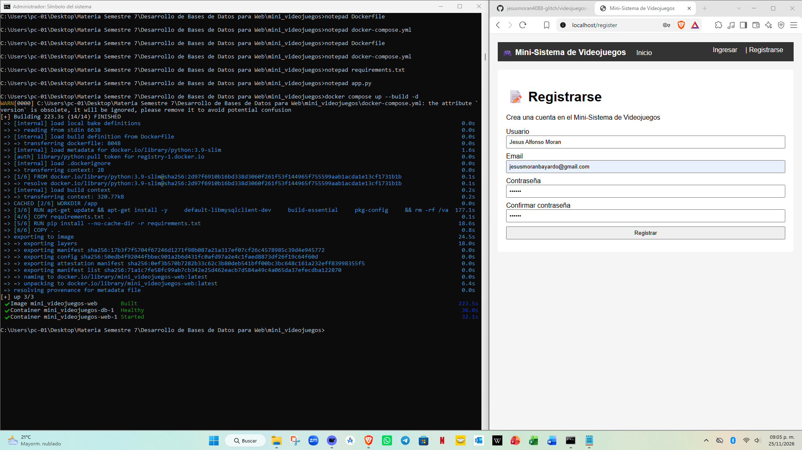
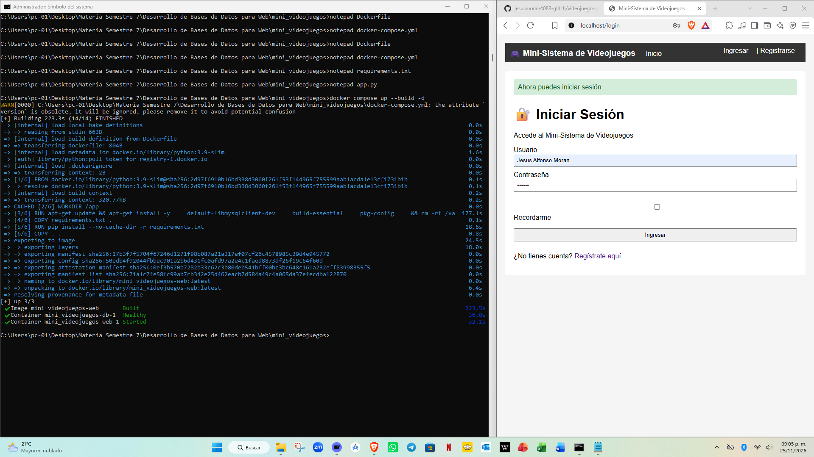
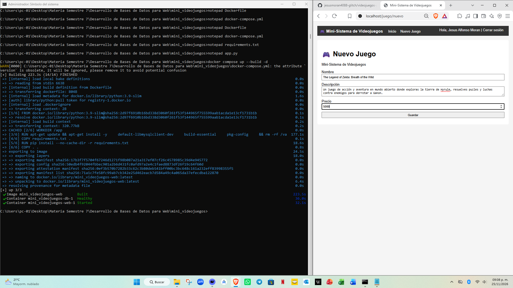

# 🎮 Mini-Sistema de Videojuegos - Despliegue en Producción

## 1. Pasos para levantar la aplicación en producción
Para desplegar la aplicación, sigue estos pasos:
1. Clonar el repositorio: `git clone https://github.com/jesusmoran4088-glitch/videojuegos-prod.git`
2. Abrir una terminal en la raíz del proyecto.
3. Ejecutar el comando de construcción y despliegue: `docker compose up --build -d`
4. Esperar a que los contenedores de MySQL y la app web inicien (el contenedor `db` debe estar en estado *Healthy*).
5. Acceder a la aplicación desde el navegador en: **[http://localhost](http://localhost)**

## 2. Variables de entorno necesarias
La aplicación utiliza las siguientes variables definidas en el `docker-compose.yml`:
* **`DATABASE_URL`**: Cadena de conexión a MySQL (`mysql+pymysql://user:pwd@db:3306/videojuegos`).
* **`SECRET_KEY`**: Clave secreta para proteger las sesiones y cookies de Flask.
* **`FLASK_ENV`**: Define el entorno (`production`) para desactivar el modo debug.

## 3. Comandos Docker / Docker Compose usados
* `docker compose up --build -d`: Construye la imagen y levanta los servicios en segundo plano.
* `docker compose ps`: Verifica el estado de los contenedores.
* `docker compose logs web`: Muestra los registros del servidor para depuración.
* `docker compose down`: Detiene y elimina los contenedores.

## 4. Capturas de pantalla de la app en ejecución

*(Como subiste las fotos con nombres numéricos, aquí las enlazamos)*

**1. Terminal con los contenedores en estado Healthy y Started:**


**2. Pantalla de Inicio de la aplicación:**


**3. Registro de nuevo usuario:**


**4. Inicio de sesión exitoso:**


**5. Agregando un nuevo videojuego:**


---

# 🧪 Pruebas Unitarias - Mini-Proyecto Flask

Este repositorio contiene la suite de pruebas unitarias diseñada para garantizar el correcto funcionamiento de la microaplicación de videojuegos. 

## 📊 Cobertura de Pruebas

- 🗄️ **Modelos (`test_models.py`):** Verifica la creación e inserción de registros en la base de datos.
- 🌐 **Rutas (`test_routes.py`):** Comprueba el acceso a rutas públicas (200) y redirección de protegidas (302).
- 🔌 **API (`test_api.py`):** Valida endpoints con códigos HTTP correctos.

## 🚧 Retos Encontrados y Soluciones

1. **Base de datos:** Se usó SQLite en memoria (`sqlite:///:memory:`) para no afectar MySQL.
2. **ID en SQLite:** Se cambió el modelo `Juego` a `Integer` con `autoincrement=True`.
3. **Importación:** Se creó `conftest.py` para evitar conflictos de módulos.

## 🚀 Ejecución de Pruebas
```bash
python -m unittest discover -v tests
